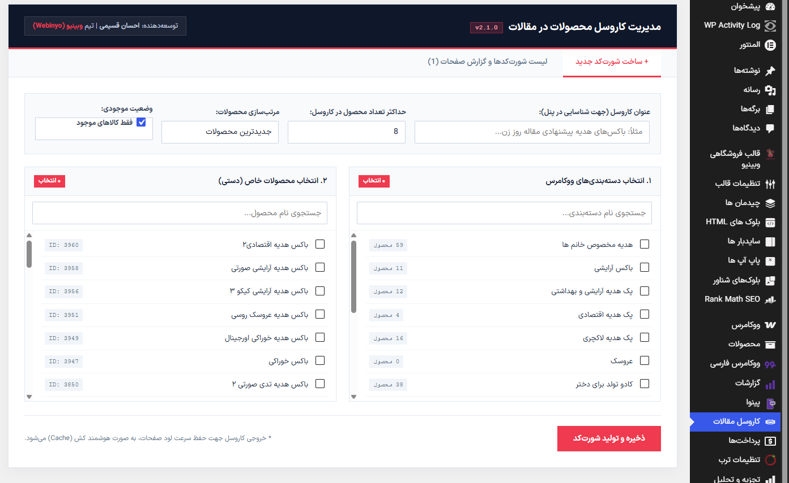

# کاروسل محصولات انتخابی در مقالات

افزونه‌ای برای وردپرس و ووکامرس که محصولات یا دسته‌بندی‌های انتخابی فروشگاه را در قالب کاروسل داخل نوشته‌ها و برگه‌ها نمایش می‌دهد.

- ساخت و مدیریت چند کاروسل از پیشخوان وردپرس
- درج کاروسل با شورت‌کد در ویرایشگر وردپرس یا ویجت شورت‌کد المنتور
- استفاده از استایل‌های قالب وودمارت در سایت‌هایی که از این قالب استفاده می‌کنند
- کش خروجی کاروسل و پاک‌سازی کش هنگام به‌روزرسانی محصول

## پیش‌نمایش پنل مدیریت




## نصب و استفاده

۱. مطمئن شوید ووکامرس فعال است و [فایل ZIP نصب افزونه](https://github.com/EhsanGhasimi/webinew-article-carousel/releases/download/v2.1.0/webinew-article-carousel.zip) را دانلود کنید.

۲. در پیشخوان وردپرس به «افزونه‌ها ← افزودن افزونه تازه ← بارگذاری افزونه» بروید، فایل ZIP را بارگذاری و افزونه را فعال کنید.

۳. در منوی «کاروسل مقالات» یک کاروسل بسازید و شورت‌کد تولیدشده را در نوشته یا برگه قرار دهید. شناسهٔ زیر نمونه است.

```text
[article_products id="123"]
```

## توسعه‌دهنده و وبینیو

**احسان قسیمی** توسعه‌دهندهٔ این افزونه و عضو تیم وبینیو است. [پروفایل احسان قسیمی در GitHub](https://github.com/EhsanGhasimi)

**وبینیو** در زمینهٔ طراحی سایت، توسعه و پشتیبانی وردپرس و سئو فعالیت می‌کند. [وب‌سایت وبینیو](https://webinew.com/) · [درباره وبینیو](https://webinew.com/about-us/)

- [خدمات طراحی سایت](https://webinew.com/webdesign/)
- [خدمات سئو](https://webinew.com/seo-in-mashhad/)
- [نمونه‌کارهای طراحی سایت](https://webinew.com/portfolio-categories/webdesign/)
- [مجله وبینیو](https://webinew.com/blog/)
